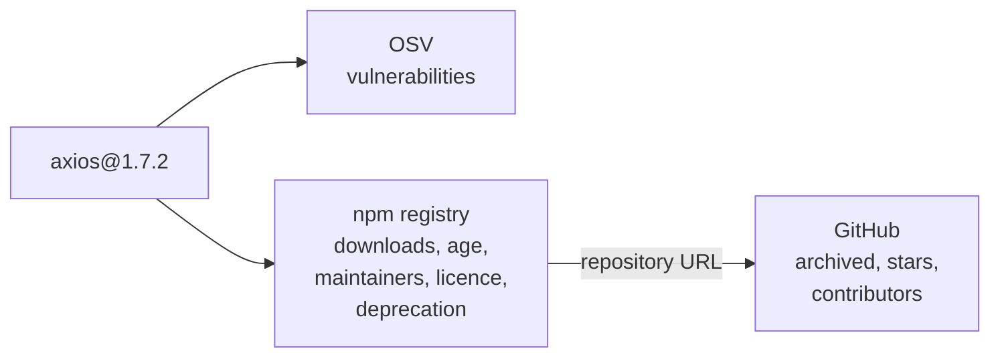

# Architecture

[← back to index](index.md)

## Where evidence comes from



OSV and npm run at the same time. **GitHub has to wait** — the only place the
repository URL exists is in npm's response.

Responses are cached for 24h. Failures are never cached.

---

## Layout

```
src/openshield/
  cli.py          command surface, no logic
  run.py          run_intercept(argv) -> int   <- the seam the shim will call
  parse.py        argv -> intercept or pass through
  resolve.py      specifier -> exact version, or Unresolvable
  collect/        osv.py  npm.py  github.py  + fan-out and degradation
  score.py        PURE — no network, no clock, no randomness
  render.py       Assessment -> text
  decide.py       the prompt
  execute.py      the only code that runs npm
  cache.py        raw responses, SQLite
  models.py       PackageRef, Evidence, Assessment, SourceRef
```

---

## Three rules that hold it together

**`score.py` is pure.** No network, no `datetime.now()`, no randomness. The
same evidence always produces the same score, which is what makes a stored
decision explicable months later. Enforced by a test that parses its imports
against an allowlist.

**`execute.py` is the only code that runs npm**, and nothing on the analysis
path can reach it — enforced the same way, transitively.

**`run_intercept(argv) -> int` is the seam.** Today you call it by typing the
command. In M2 the `PATH` shim calls it. Nothing else in the codebase learns
that interception exists, which is why adding the shim is a small change
rather than a rewrite.

---

## Ages are computed at parse time, not fetch time

A subtle one worth knowing before touching the collectors.

The cache stores **raw responses** with their original timestamps. Day counts
like `days_since_last_publish` are derived when the response is *parsed*, which
happens on every run — cache hit or miss.

Store the computed age instead and a 23-hour-old cache hit hands the scorer a
number that's 23 hours wrong, and the same package scores differently depending
on cache state.