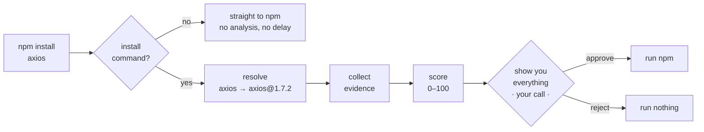

# OpenShield

**A pause between `npm install` and running someone else's code.**

`npm audit` runs *after* install — after `postinstall` scripts have already
executed. OpenShield runs *before*, on the exact versions you're about to get,
and waits for you to say yes.

macOS · npm · direct dependencies only

---

## What happens when you run it



**The pause is the product.** Everything else exists to make it worth the two
seconds. Nothing is ever installed without you saying so.

---

## Try it

```bash
# read-only — analyses, installs nothing
uv run openshield check axios
uv run openshield check lodash@4.17.11

# the full loop — analyses, then asks
uv run openshield intercept -- npm install axios
```

A handy alias while there's no shim yet:

```bash
alias ni='openshield intercept -- npm install'
```

---

## Known limits

Read these. They're true of the finished tool, not just today.

1. **Direct dependencies only.** You're reviewing what you typed, not what npm
   resolves beneath it.
2. **"Clean" means nothing known against it** — every vulnerability database is
   a record of what someone already caught.
3. **Not a sandbox.** It raises the cost of an accident, not of an attack.
   Anything calling npm by absolute path bypasses it.
4. **Lockfile installs aren't reviewed.** Bare `npm install` and `npm ci` pass
   through with a notice. This is the biggest gap.
5. **Scores order your attention.** The evidence underneath is the real output.

---

## The rest of the docs

| | |
| --- | --- |
| [usage.md](usage.md) | commands, output, exit codes, config |
| [architecture.md](architecture.md) | where evidence comes from, module layout |
| [roadmap.md](roadmap.md) | what's built, what's next |